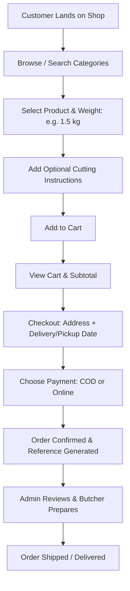
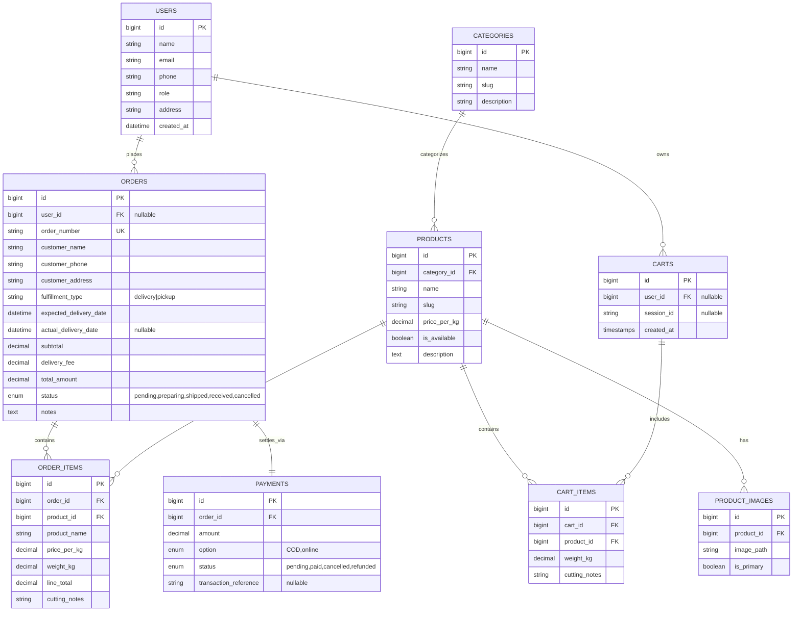

# Product Requirements Document (PRD): Evic Meat & Poultry Shop

- **Document Version:** 1.0.0
- **Status:** Approved / Ready for Implementation
- **Target Platform:** Web (Desktop & Mobile Responsive)
- **Tech Stack:** Laravel 12/13, Inertia.js v3, Vue 3 (Composition API), Tailwind CSS v4, Wayfinder, Fortify, Pest

---

## 1. Executive Summary & Vision

### 1.1 Product Overview
**Evic Meat & Poultry Shop** is an e-commerce and retail order management platform designed specifically for the fresh meat and poultry retail trade. Unlike generic e-commerce platforms selling fixed-unit packaged goods, a fresh meat shop requires support for **weight-based pricing** (price per kilogram), **custom butchery/cut specifications** (e.g., sliced, deboned, chopped into curry cuts), **temperature-sensitive delivery scheduling**, and **flexible payment options** (Cash on Delivery / E-Wallets).

This project serves as both a high-standard real-world solution for the shop and a comprehensive full-stack learning architecture utilizing Laravel, Inertia v3, and Vue 3.

### 1.2 Problem Statement
- **Perishable & Weight-Based Goods:** Meat cuts vary in weight and price per kg. Standard e-commerce carts assume integer unit quantities (1 box, 2 shirts).
- **Customer Cut Preferences:** Shoppers have specific preparation requirements (e.g., "skinless breast", "chop ribs into 2-inch cubes").
- **Inventory & Freshness:** Items run out quickly depending on daily slaughter/delivery batches. Out-of-stock items need immediate visibility.
- **Order Fulfillment Coordination:** Orders require butcher preparation, weighing, cold-storage packaging, and scheduled delivery or pickup.

### 1.3 Core Objectives & Success Metrics
| Objective | Success Metric |
| :--- | :--- |
| **Effortless Browsing & Ordering** | Customer can locate a cut, choose weight & prep preference, and check out in < 3 minutes. |
| **Accurate Weight-Based Pricing** | Support decimal quantities (e.g. 0.5 kg, 1.25 kg) with dynamic price calculation. |
| **Operational Efficiency** | Shop staff can view, prepare, weigh, and update order statuses in real time from a dedicated admin board. |
| **Reliable Fulfillment** | Clear dispatch dates, expected delivery times, and transparent payment tracking (COD / Online). |

### 1.4 Goals, Non-Goals & Anti-Goals
- **Goals:**
  - Responsive, modern storefront for retail meat shoppers (mobile-first).
  - Categorized catalog (Poultry, Pork, Beef, Processed / Marinated).
  - Weight-based selector (increments in kg or half-kg) + custom cutting instructions note per item.
  - Cart, guest-friendly or authenticated checkout, and schedule-aware delivery/pickup options.
  - Admin management for products, stock availability toggle, order lifecycle tracking, and invoice printing.
- **Non-Goals (MVP):**
  - Multi-vendor marketplace (this is a single-merchant storefront).
  - Hardware integration with digital Bluetooth butcher scales (weights entered via web UI).
  - Automated GPS driver routing (fulfilled via standard courier or store riders).
- **Anti-Goals:**
  - Bloated enterprise ERP workflows that complicate simple retail transactions.
  - Forcing mandatory account registration before a customer can view meat cut prices.

---

## 2. User Personas & Target Audience

### 2.1 Maria (The Home Cook / Household Shopper)
- **Demographics:** Age 32, cooks daily meals for her family.
- **Pain Points:** Wants fresh dressed chicken and pork cuts without enduring crowded, wet traditional wet markets.
- **Needs:** Clear photos of fresh meat, unambiguous price per kg, option to request "deboned & sliced", scheduled morning delivery before lunch cooking.

### 2.2 Chef Dan (The Small Restaurant / Canteen Operator)
- **Demographics:** Age 41, manages a local diner.
- **Pain Points:** Needs consistent bulk cuts (5–10 kg chicken thighs, 8 kg ground pork) 3 times a week.
- **Needs:** Rapid re-ordering from past orders, invoice generation, dependable delivery times.

### 2.3 Eric / Store Staff (The Shop Owner & Butcher)
- **Demographics:** Age 35, runs the daily shop operations.
- **Pain Points:** Gets overwhelmed with phone/chat messages with messy orders; forgets cut instructions; needs to mark out-of-stock meats quickly.
- **Needs:** Clean dashboard showing pending orders, customer cutting instructions, one-click order status transitions (`pending` &rarr; `preparing` &rarr; `shipped` &rarr; `received`).

---

## 3. Standard User Experience & Core Journeys

### 3.1 Customer Experience (Storefront)
1. **Home & Catalog:**
   - Hero banner highlighting today's fresh slaughter/arrivals.
   - Category navigation tabs: *All, Poultry, Pork, Beef, Seasoned/Ready-to-Cook, Offal/Special Cuts*.
   - Product cards: Thumbnail photo, name, category badge, stock status badge (`Available` / `Sold Out Today`), price per kg.
2. **Product Details & Cut Configuration:**
   - High-res product images.
   - Price display: `₱ / $ per kg` and dynamic calculated price based on chosen quantity.
   - Quantity selector: Increment buttons (`-`, `+`) supporting decimal kilograms (0.5 kg, 1 kg, 1.5 kg, etc.) or unit packages.
   - Preparation notes input (e.g., "Cut into adobo size", "Separate skin", "Ground twice").
3. **Shopping Cart:**
   - Slide-over drawer or dedicated cart page.
   - Shows item name, image, selected weight, prep notes, line total.
   - Ability to adjust weight or remove items.
   - Subtotal, estimated delivery fee, and total calculation.
4. **Checkout Flow:**
   - Customer Contact (Name, Phone number, Email).
   - Fulfillment Type: **Local Delivery** (requires address & delivery instructions) or **Store Pickup**.
   - Date & Time Slot: Choice of available delivery dates (e.g. Tomorrow Morning 8:00 AM - 11:00 AM).
   - Payment Method: **Cash on Delivery (COD)** or **Online Payment (GCash / Bank Transfer / Stripe)**.
5. **Order Confirmation & Tracking:**
   - Order confirmation page with unique Order Reference ID (e.g., `#EVIC-2026-1042`).
   - Visual status timeline: `Pending` &rarr; `Preparing / Cut` &rarr; `Out for Delivery` &rarr; `Delivered`.
   - Contact quick links (Call Shop / WhatsApp / Messenger).

### 3.2 Merchant & Butcher Experience (Admin Dashboard)
1. **Overview Dashboard:**
   - Key metrics: Today's revenue, active orders to cut/pack, out-of-stock items, total completed deliveries.
2. **Product & Inventory Management:**
   - Create, edit, delete products.
   - Upload high-resolution cut images.
   - Set category, unit type (`kg`, `pack`, `piece`), price per unit/kg.
   - One-click toggle: `is_available` (instantly marks item as sold out on storefront).
3. **Order Processing Board:**
   - Kanban or filtered table: `Pending` | `Preparing` | `Shipped / Out for Delivery` | `Completed` | `Cancelled`.
   - Detailed Order View: Customer details, delivery address, selected slot, payment status, list of items with exact weights and customer butchery notes.
   - Action buttons: "Mark as Preparing", "Mark as Shipped", "Mark as Delivered", "Print Butcher Slip".

---

## 4. Functional Specifications

### 4.1 Module 1: Catalog & Inventory
- **FR-1.1:** System shall store categories with name, slug, description, and display order.
- **FR-1.2:** System shall store products with name, slug, category, price per kg/unit, availability flag, and description.
- **FR-1.3:** System shall support multiple images per product with a primary display thumbnail.
- **FR-1.4:** When `is_available = false`, the storefront disables the "Add to Cart" button and displays a "Sold Out" badge.

### 4.2 Module 2: Cart & Weight Engine
- **FR-2.1:** Cart items must store `product_id`, `quantity` (decimal, representing weight in kg), and optional `cutting_instructions` (string).
- **FR-2.2:** Subtotal must calculate: `round(price_per_kg * quantity, 2)`.
- **FR-2.3:** Guest carts shall persist via session / local storage and synchronize upon customer login.

### 4.3 Module 3: Checkout & Scheduling
- **FR-3.1:** Customer must specify full delivery address or select store pickup.
- **FR-3.2:** System shall enforce selection of `expected_delivery_date` and delivery time window (preventing past date selection).
- **FR-3.3:** Supported payment types: `COD` (Cash on Delivery) and `online` (Manual Proof or Gateway integration).

### 4.4 Module 4: Order Lifecycle & Management
- **FR-4.1:** Orders status transitions:
  - `pending`: Order placed, waiting for merchant confirmation.
  - `preparing`: Butcher is currently cutting and packaging the order.
  - `shipped`: Handed over to delivery rider / courier.
  - `received`: Confirmed delivered and payment settled.
  - `cancelled`: Cancelled by user or shop (with cancellation reason).
- **FR-4.2:** Payment status transitions: `pending`, `paid`, `cancelled`, `refunded`.
- **FR-4.3:** Order details must snapshot historical product price and name at time of purchase.

### 4.5 Module 5: Authentication & Roles
- **FR-5.1:** Customers can register, login, view past orders, and manage saved delivery addresses.
- **FR-5.2:** Admin role protected via middleware for accessing back-office routes (`/admin/*`).

---

## 5. Data Model & Entity Relationship

---

## 6. User Interface & Information Architecture

### 6.1 Storefront Layout
- **Header:** Shop Branding / Logo, Category Quick Links, Search Bar, Cart Button with active item/weight count badge, User Account dropdown.
- **Main Catalog Grid:** Responsive grid (2-columns on mobile, 4-columns on desktop).
  - Clean card design featuring meat imagery, badges for availability, clear bold price `₱XXX.XX / kg`, and quick weight selector.
- **Cart Slide-Over:** Instant drawer allowing quick adjustments without leaving the browsing flow.
- **Checkout Page:** Single-page 2-column checkout (Form fields on left, Order summary & delivery slot on right).

### 6.2 Admin Back-Office Layout
- **Sidebar Navigation:**
  - Dashboard (Metrics & Daily Highlights)
  - Orders (Incoming, In-Preparation, Dispatched, History)
  - Products & Categories (Catalog Management)
  - Customer List
- **Order Details Drawer/Modal:**
  - Printable butchery prep slip (customer name, items, weights, specific cut requests, delivery window).
  - Status progression buttons.

---

## 7. Edge Cases & Business Rules

1. **Catch-Weight Discrepancy (Actual Weight vs Estimated Weight):**
   - *Rule:* In meat retailing, a customer ordering `1.0 kg` of pork belly may receive a cut that ends up being `1.04 kg` or `0.98 kg`.
   - *Standard UX Solution:* Carts calculate estimated cost based on chosen weight. For Cash on Delivery, receipt reflects final weighed total if adjusted by butcher; for prepaid, standard tolerance threshold or refund/settlement options are supported.
2. **Cut Cutoff & Preparation Lead Times:**
   - *Rule:* Fresh meat preparation takes time. Same-day delivery must require orders placed before a cutoff time (e.g., 2:00 PM). Otherwise, next available slot is the following morning.
3. **Product Goes Out of Stock During Checkout:**
   - *Rule:* If an admin marks an item `is_available = false` while a user has it in their cart, checkout will highlight the unavailable item and prompt removal before proceeding.
4. **Order Cancellation Window:**
   - *Rule:* Customers can only cancel an order while it is in `pending` status. Once the butcher begins cutting (`preparing`), cancellation requires direct store contact to prevent meat waste.

---

## 8. Implementation Milestones

- [ ] **Milestone 1: Database & Model Refinements**
  - Update migrations: add `order_items` table snapshotting historical prices, add `cutting_notes` and decimal weight to `cart_items` and `order_items`.
  - Set up Eloquent models, relationships, and model factories.
- [ ] **Milestone 2: Catalog & Storefront UI (Inertia + Vue 3)**
  - Build responsive catalog with Category filtering and Search.
  - Implement Product Detail view with decimal weight selection and cutting preference notes.
- [ ] **Milestone 3: Weight-Aware Cart & Checkout**
  - Cart state management (add, update weight, remove).
  - Checkout form with delivery slot date/time selector and COD/Online payment choice.
  - Order creation and confirmation page.
- [ ] **Milestone 4: Admin Management & Fulfillment Board**
  - Admin dashboard displaying daily orders and revenue.
  - Order status manager (`pending` &rarr; `preparing` &rarr; `shipped` &rarr; `received`).
  - Product catalog CRUD with availability toggling.
- [ ] **Milestone 5: Verification & Pest Tests**
  - Unit tests for cart price calculations and weight increments.
  - Feature tests for order placement and status transitions.
